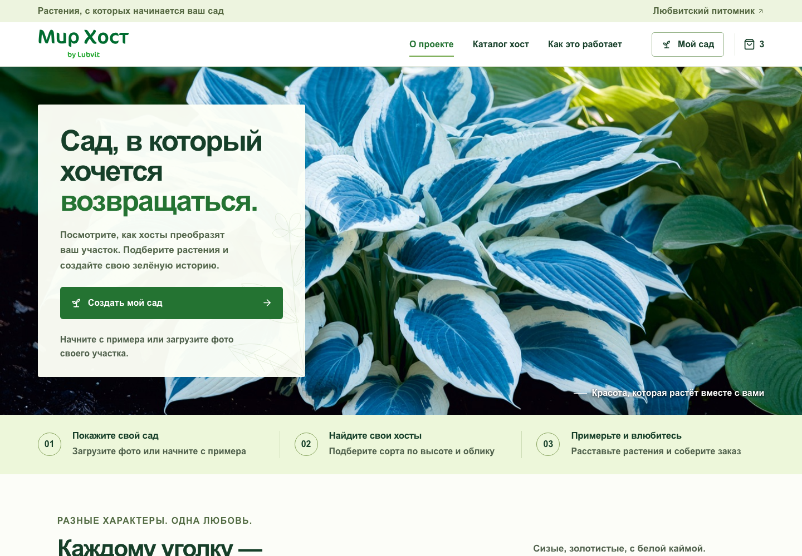
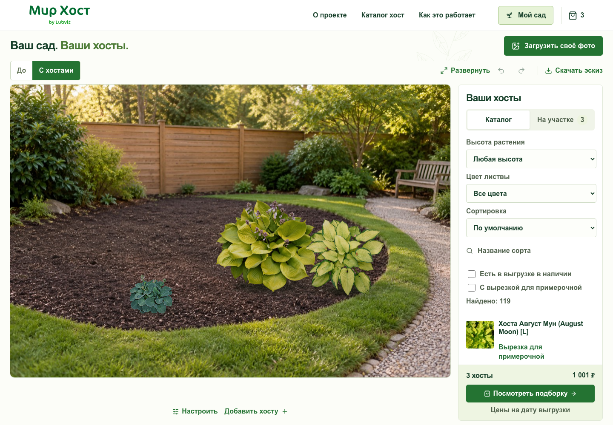
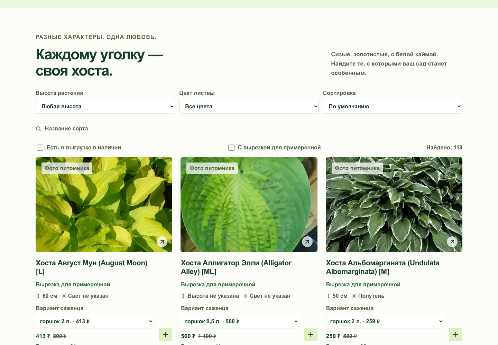
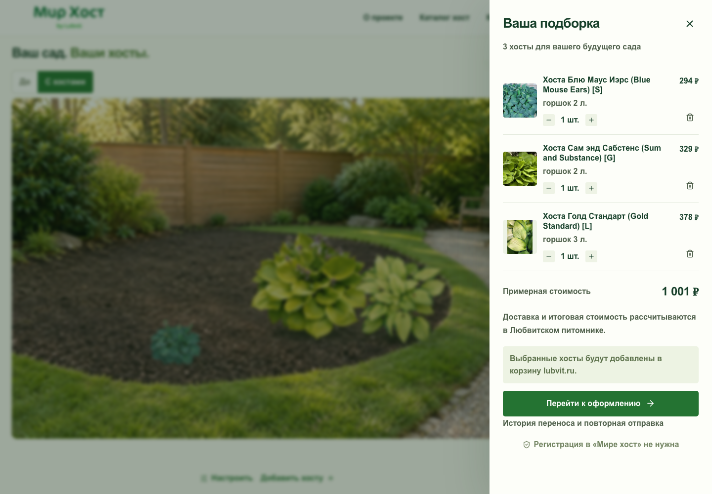
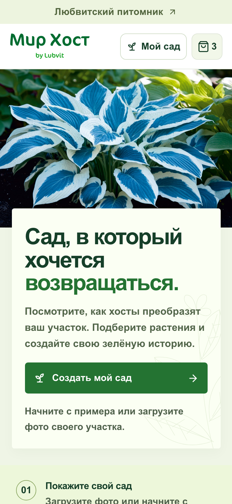

# Мир хост — интерактивная примерочная растений

**Веб-приложение для Любвитского питомника: от идеи клумбы на фотографии своего участка до подборки растений для покупки.**

Пользователь загружает фото сада, расставляет хосты из каталога, сравнивает результат с исходным снимком и сохраняет эскиз. Растения на сцене формируют подборку, которую можно передать в корзину питомника.

[Открыть проект](https://hostaworld.ru) · [Перейти в примерочную](https://hostaworld.ru/garden) · [Исходный код приложения](https://github.com/vrudenko-kk/Hosta-world)

**Next.js 16 · React 19 · TypeScript · Konva · Zustand · Node.js 24 · MySQL 8 · GitHub Actions**

## Задача проекта

По отдельной фотографии товара сложно представить, как разные сорта будут сочетаться на участке. Примерочная помогает собрать визуальный эскиз будущей клумбы и связать его с конкретными вариантами саженцев, их стоимостью и наличием.

В проекте объединены адаптивный интерфейс, редактор на Canvas, локальное хранение пользовательского сада, серверная проверка подборки и интеграции с каталогом питомника.

## Что можно сделать

| Возможность | Реализация |
| --- | --- |
| Подобрать сорта | Поиск по названию, фильтры по высоте и цвету листвы, наличию и готовым вырезкам; сортировка по цене и названию |
| Выбрать вариант саженца | Разные объёмы горшков, отдельные цены и остатки для каждого SKU |
| Примерить растения | Фото своего участка или готовый пример; перетаскивание, масштабирование, поворот, отражение и настройка яркости |
| Отредактировать композицию | Дублирование и удаление растений, отмена и повтор действий, управление с клавиатуры и сенсорные жесты |
| Оценить результат | Переключение «До / С хостами», развёрнутый режим, экспорт эскиза в PNG |
| Продолжить позже | Автосохранение растений и фотографии в текущем браузере без регистрации |
| Перейти к покупке | Подборка из растений на сцене, изменение количества, серверная проверка и перенос в гостевую корзину lubvit.ru |

В сохранённом каталоге — **119 сортов и 310 вариантов саженцев** по выгрузке от 23 октября 2026 года. Это объём снимка каталога в коде, а не обещание неизменного наличия в магазине.

## Интерфейс

### Примерочная

Холст с композицией и каталог находятся рядом: можно подбирать растения и сразу видеть результат на фотографии. Для сцены предусмотрены учёт глубины посадки, начального размера сорта и освещения, тени и порядок наложения растений.

### Каталог

Карточки содержат фотографии, характеристики, варианты саженцев и цены. Фильтры можно комбинировать; выбранный вариант определяет стоимость и доступное количество.

### Подборка

Состав подборки связан со сценой: каждый размещённый экземпляр учитывается в количестве для заказа. Оформление и оплата проходят на стороне питомника.

<strong>Мобильная версия</strong>

Интерфейс адаптируется к небольшим экранам; редактор поддерживает сенсорное управление.

## Технические решения

### Canvas-редактор и единое состояние

Редактор построен на **Konva / react-konva**, состояние композиции — на **Zustand**. Координаты и параметры растений хранятся отдельно от отрисовки. Из одной модели формируются сцена, история изменений и подборка для покупки: отдельную корзину, расходящуюся с эскизом, поддерживать не требуется. Лимит сцены — 40 растений; при добавлении учитывается доступное количество выбранного варианта.

### Работа с фотографиями в браузере

Исходное фото сохраняется как Blob в **IndexedDB**, параметры растений — в **localStorage**. Для редактора создаётся уменьшенное превью, исходник остаётся доступен для экспорта. Фото участка не отправляется на сервер. При восстановлении проверяется схема данных; предусмотрены миграция прежних идентификаторов сортов и сообщения об ошибках хранилища.

### Каталог и обмен CommerceML

Серверная часть поддерживает JSON-снимок и источник **MySQL 8**. Реализован приёмник **CommerceML 2** с этапами `checkauth → init → file → import`, загрузкой XML частями и приёмом ZIP. Каталог публикуется транзакционно: ошибка импорта не должна оставлять витрину с частично обновлёнными данными.

Предусмотрены полные и частичные обновления, проверка версий, безопасный повтор импорта и отклонение конфликтующих сеансов. XML разбирается потоково через **saxes**, ZIP — через **yauzl**; входные данные проверяются **Zod**. Отдельный синхронизатор сопоставляет варианты с магазином по идентификаторам 1С из публичного YML и карточек товаров.

### Передача подборки в магазин

Перед переносом сервер проверяет связь SKU с товаром магазина и доступное количество. Браузер последовательно отправляет позиции через штатные формы lubvit.ru, затем открывает оформление. Журнал попыток в localStorage и **Web Locks** помогают избежать повторной автоматической отправки из нескольких вкладок. Неоднозначный результат не повторяется автоматически: предусмотрены история переноса и продолжение оставшейся очереди.

### Безопасность и эксплуатация

Реализованы проверка Origin для запросов изменения данных, ограничения размеров запросов, проверка разрешённых адресов магазина и **Content Security Policy** с nonce. Для Canvas предусмотрены клавиатурные альтернативы, для диалогов — нативный `<dialog>`, для анимаций — учёт `prefers-reduced-motion`.

В репозитории приложения настроены **GitHub Actions**, публикация `main` на VPS с **Nginx / systemd** и тестовая публикация `dev` на Vercel. Процесс VPS-публикации включает проверки, сборку отдельного релиза и переключение на него после успешной проверки. Подготовлены средства мониторинга, резервного копирования и инструкции восстановления.

## Стек

| Область | Технологии |
| --- | --- |
| Интерфейс | Next.js 16, App Router, React 19, TypeScript, CSS, Lucide |
| Интерактивная сцена | Konva, react-konva, Canvas API |
| Состояние и хранение в браузере | Zustand, localStorage, IndexedDB |
| Сервер и проверка данных | Node.js 24, Next.js Route Handlers, Zod |
| Каталог и импорт | MySQL 8, mysql2, CommerceML 2, XML, ZIP, YML |
| Проверки | Node.js test runner, tsx, TypeScript, интеграционные тесты MySQL |
| Публикация | GitHub Actions, VPS, Nginx, systemd, Vercel для ветки dev |

## Проверки и границы реализации

В исходном проекте есть автоматические проверки каталога, фильтров и сортировки, преобразований растений, сохранения сада, параметров экспорта, корзины, передачи подборки и безопасности запросов. Отдельные интеграционные тесты проверяют обмен CommerceML с MySQL: публикацию, частичные обновления, откат ошибок, повторные и конкурентные запросы. Предусмотрены проверки типов, production-сборки и HTTP-доступности приложения.

- Примерочная создаёт редактируемый **визуальный коллаж**; она не выполняет ИИ-генерацию или автоматическую сегментацию участка и не гарантирует точный вид взрослой посадки.
- Источник каталога и включение обмена зависят от настроек окружения. Наличие приёмника в коде само по себе не означает настроенное расписание реальной 1С.
- Перенос в магазин проходит между двумя сайтами; он не является атомарной операцией и не гарантирует доставку «ровно один раз». Итоговый состав проверяется в корзине питомника.
- Сохранённый сад привязан к браузеру и домену. Личный кабинет и синхронизация между устройствами не реализованы.

## Как посмотреть

1. Открыть [hostaworld.ru/garden](https://hostaworld.ru/garden) — стартовая композиция уже подготовлена.
2. Добавить растение из каталога, изменить его положение и размер, попробовать отмену действия.
3. Сравнить исходное фото с результатом и скачать PNG-эскиз.
4. Открыть подборку, чтобы увидеть связь растений на сцене с количеством и стоимостью.

Этот репозиторий содержит презентацию проекта и скриншоты. Код приложения находится в [Hosta-world](https://github.com/vrudenko-kk/Hosta-world); доступ к нему определяется настройками основного репозитория.

Описание сверено с исходным кодом версии b50c18a. Скриншоты сделаны 7 ноября 2026 года на локальной версии с сохранённым каталогом. Фотографии и фирменные материалы представлены в составе интерфейса проекта Любвитского питомника.
